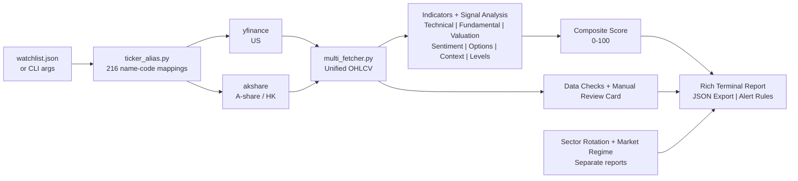
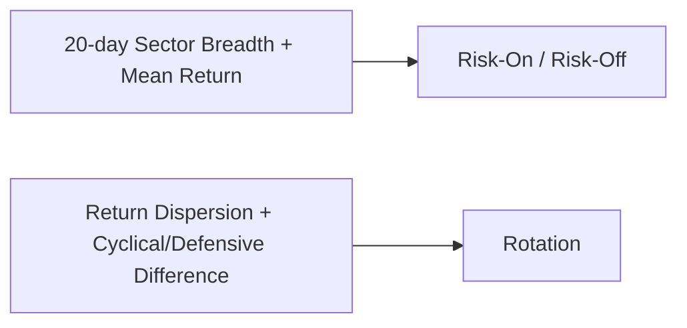
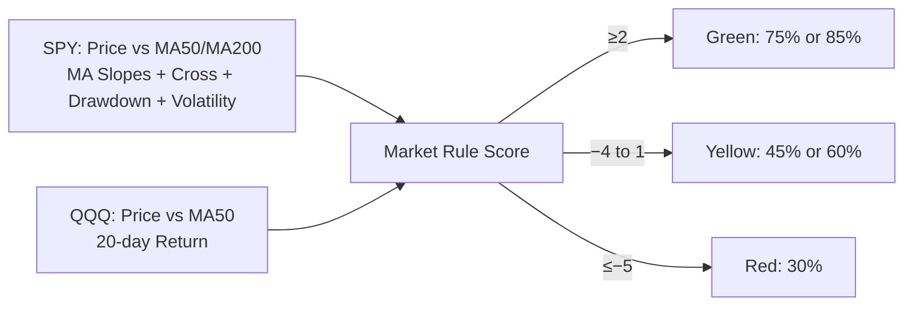
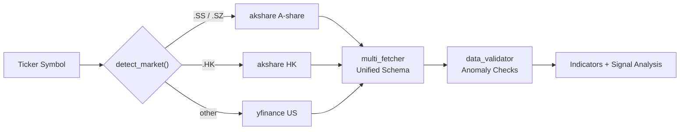

# 📈 Stock Monitor — Multi-Dimension Technical Analysis System

[](LICENSE)
[](https://www.python.org/)
[](https://github.com/KAMCHIU-LAB/Stock_Monitor)

**English** | [简体中文](README_zh.md)

Rule-based analysis engine for **US / A-share / HK equity markets**. Combines technical, fundamental, valuation, news, options, market comparison, and key-level signals into a score. Data checks, sector rotation, and market regime reports add context and review prompts.

**No API keys. No database. Zero config** — Python 3.10+ with yfinance + akshare.

Scores are heuristic summaries, not calibrated probabilities or validated return forecasts. See [data quality and method limitations (中文)](AUDIT.md).

## Quick Start

### Install

Run these commands from the project root with Python 3.10+ (macOS / Linux):

```bash
python3 -m venv .venv
source .venv/bin/activate
python -m pip install -r requirements.txt
```

### Configure Watchlist

Create `watchlist.json` in the project root (or run `python main.py --init-watchlist`):

```json
{
  "_note": "Fields starting with _ are metadata, not loaded",
  "core_index": ["SPY", "QQQ", "IWM"],
  "mag7": ["MSFT", "AAPL", "NVDA", "GOOGL", "AMZN", "META", "TSLA"],
  "hk": ["0700.HK", "9988.HK"]
}
```

Supports ticker symbols and names in Chinese / English (auto-resolved via `ticker_alias.py`).

Plain text format also supported: `watchlist.txt` — one symbol per line, `#` for comments.

### Run

```bash
python main.py                         # watchlist.json → watchlist.txt → config.py defaults
python main.py -s MSFT GOOGL AAPL      # specific stocks
python main.py -s MSFT --json          # JSON-formatted results
python main.py --watchlist mylist.json # custom JSON/TXT watchlist
python main.py -s MSFT --local         # offline fixture demo
python main.py -s MSFT --interval 60   # refresh every 60 min
python main.py --sector                # sector rotation ranking
python main.py --market-status         # market regime indicator
python main.py --all                   # full analysis pipeline
```

`--local` loads `.cache/<symbol>.csv` or generates synthetic prices when that file is absent. It skips external per-stock data; the result is a demo, not current market analysis. `--sector`, `--market-status`, and those stages of `--all` still require network access.

`--json` formats results as JSON, but data-fetch and watchlist messages may also appear on stdout. Inspect the output before using it as a machine-readable stream.

The default `watchlist.json`, `watchlist.txt`, and `.cache/` are gitignored. Custom watchlist filenames and exported reports are not automatically ignored; keep private holdings out of commits and shared output.

---

## Highlights

- 🌏 **Three markets in one engine** — US stocks via yfinance, A-shares & HK stocks via akshare, market auto-detected from ticker format
- 📐 **Signal-based scoring** — combines bullish and bearish signal weights; sector rotation, market regime, and data checks are reported separately
- 🚦 **Market regime traffic light** — SPY/QQQ trend, momentum, and risk rules → green / yellow / red status
- 🔄 **Sector rotation radar** — multi-period returns and momentum across 11 SPDR sector ETFs + price-based risk-on / risk-off labels
- 🀄 **Type stock names in plain Chinese or English** — `"茅台"`, `"Tencent"`, `"Microsoft"` all resolve to tickers (216 built-in aliases)
- 📊 **Rich terminal reports** — data review card, key support/resistance levels, signal conflict warnings; JSON-formatted results

---

## Architecture



## Scoring Model

### Composite Score

[`calculate_composite_score`](analyzer.py) sums the weights of bullish and bearish signals:

$$
\text{Base score} = \operatorname{clip}_{0,100}\left(\operatorname{int}\left(50 + 3\left(\sum w_{bullish} - \sum w_{bearish}\right)\right)\right)
$$

Each signal carries its own `weight`; neutral signals do not change the score. `full_analysis` collects signals from technical analysis, fundamentals, historical valuation, news sentiment, options, market comparison, and support/resistance analysis. Available coverage varies by market; A-share/HK news and options analysis currently return neutral placeholders.

The final score applies two further rules, in order:

1. If both bullish and bearish signals have weights of at least 3, shrink the score toward 50: `int(50 + (base_score - 50) * 0.4)`.
2. Apply the technical trend cap. The current `强势下跌` (strong downtrend) label caps the score at 45. The `震荡偏空` (bearish consolidation) label does not trigger that cap.

The `DIMENSION_WEIGHTS` constant in `analyzer.py` is not used by this calculation. Data quality is attached to the report. Outputs from `sector_rotation.py` and `market_status.py` run as separate reports and do not feed the per-stock score in the current CLI; `market_context.py` contributes its own benchmark and market-environment signals.

### Technical Trend Classification

`analyze_trend` classifies direction separately from the signal score:

| Check | Up / Down Votes |
|-------|-----------------|
| Close above / at or below MA50 | 2 / 2 |
| MA50 change over 10 observations above +0.5% / below −0.5% | 1 / 1 |
| MACD DIF above / at or below zero | 1 / 1 |

Unavailable values are skipped. Up votes ≥3 produce `强势上涨`, then up votes ≥2 produce `震荡偏多`; otherwise down votes ≥3 produce `强势下跌`, down votes ≥2 produce `震荡偏空`, and the remainder produce `横盘震荡`. Bollinger mid-band position is displayed as supporting detail and adds no vote.

### Score-to-Label Mapping

| Score Range | Signal | Code |
|:-----------:|--------|----------|
| 80–100 | Strong Buy | `STRONG_BUY` |
| 60–79 | Bullish | `BUY` |
| 40–59 | Neutral | `HOLD` |
| 20–39 | Bearish | `SELL` |
| 0–19 | Strong Sell | `STRONG_SELL` |

Thresholds come from `THRESHOLDS` in [`config.py`](config.py). These are rule labels, not validated trading outcomes.

## Sector Rotation Algorithm

### Multi-Period Momentum Scoring

$$
\text{Momentum} = 3 \times R_5 + 2 \times R_{20} + R_{60}
$$

$R_n$ is the n-observation percentage price change. Missing periods add no contribution. [`sector_rotation.py`](sector_rotation.py) computes this value alongside separate 5/20/60-period return rankings. The terminal table ranks by 20-period return; the momentum value is not normalized to 0–100.

### Price-Based Market Style Labels



| Condition | Signal | Interpretation |
|-----------|--------|----------------|
| ≥70% of available sectors rise and mean 20-day return >2% | Risk-On | Broad positive price momentum |
| ≥70% fall and mean 20-day return <−2% | Risk-Off | Broad negative price momentum |
| Return standard deviation >4 percentage points; group mean difference >3 points | Cyclical / defensive rotation | Cyclicals: XLY/XLI/XLE/XLB; defensives: XLP/XLV/XLU |
| Standard deviation >4 points without either group lead | Rotation | Sector dispersion |
| Remaining cases | Neutral | No rule above matched |

The rules run in table order. These labels infer market style from price returns; they do not measure actual fund inflows or outflows.

## Market Regime Detection

### SPY / QQQ Rule Score



| Market Score | Regime | Position Heuristic |
|:------------:|--------|:------------------:|
| ≥5 | Green / bull trend | 85% |
| 2–4 | Green / mild bull | 75% |
| −1–1 | Yellow / consolidation | 60% |
| −4–−2 | Yellow / mild bear | 45% |
| ≤−5 | Red / bear trend | 30% |

See [`market_status.py`](market_status.py) for the weights and thresholds. If SPY or QQQ fetching fails, the module returns yellow / unknown with a 60% placeholder. These percentages are fixed rule outputs and are not personalized portfolio allocations.

## Data Pipeline



The unified history path in `multi_fetcher.py` calls providers directly. Separate helpers in `data_fetcher.py` use `cache.py` with caller-specific TTLs; there is no universal 30-minute cache over this pipeline.

---

## Ticker Symbol Format

| Market | Format | Example |
|--------|--------|---------|
| US | Ticker symbol | `MSFT`, `AAPL`, `NVDA` |
| A-share (Shanghai) | Code + `.SS` | `600519.SS` (Moutai), `601318.SS` (Ping An) |
| A-share (Shenzhen) | Code + `.SZ` | `000858.SZ` (Wuliangye), `300750.SZ` (CATL) |
| Hong Kong | Code + `.HK` | `0700.HK` (Tencent), `9988.HK` (Alibaba) |

### Name Resolution

The system supports mixed input of ticker codes and company names (Chinese / English):

```json
{
  "my_stocks": ["MSFT", "微软", "Tencent", "0700.HK", "茅台"]
}
```

All names are resolved to standard ticker symbols before analysis. Alias dictionary covers 216 entries across US mega-caps, HK blue chips, A-share leaders, and major ETFs.

### Common Tickers Reference

```
US Mega-Caps:
  AAPL  Apple           MSFT  Microsoft       GOOGL Alphabet
  AMZN  Amazon          NVDA  NVIDIA          META  Meta
  TSLA  Tesla

US Notable:
  NFLX  Netflix         AMD   AMD             CRM   Salesforce
  AVGO  Broadcom        ORCL  Oracle          JPM   JPMorgan
  BRK.B Berkshire       V     Visa            COST  Costco

Index / ETF:
  SPY   S&P 500         QQQ   Nasdaq 100      IWM   Russell 2000
  DIA   Dow Jones       ARKK  ARK Innovation  SOXX  Semiconductors

Sector ETFs (rotation tracking):
  XLK   Technology      XLF   Financials      XLE   Energy
  XLV   Healthcare      XLY   Cons. Disc.     XLP   Cons. Staples
  XLI   Industrials     XLB   Materials       XLRE  Real Estate
  XLU   Utilities       XLC   Comm. Services

Hong Kong:
  0700.HK  Tencent      9988.HK  Alibaba      9888.HK  Baidu
  3690.HK  Meituan      1810.HK  Xiaomi       9618.HK  JD.com

A-Share:
  600519.SS  Moutai     000858.SZ  Wuliangye  300750.SZ  CATL
  601318.SS  Ping An    002594.SZ  BYD        600036.SS  CMB
```

---

## Report Structure

### Data Review Card

Displayed at the top of every report for manual comparison with a broker or another source. The program checks anomalies and field consistency; it does not automatically verify prices against an independent provider.

| Field | Description |
|-------|-------------|
| Data Date | Last trading day of fetched data |
| Close Price | Settlement price from data source |
| Live Price | Real-time quote (may differ during pre/post market) |
| Currency | USD / HKD / CNY |
| Market State | PRE / POST / REGULAR |

### Composite Score

```
██████████████████░░   Visual score bar
Score: 92/100          0-100, higher = more bullish
Signal: Strong Buy     5 levels: Strong Buy / Bullish / Neutral / Bearish / Strong Sell
Trend:  Bullish        Triple confirmation: price vs MA + MA slope + MACD
```

### Key Levels

```
Current:  $373.51
R1:       $376.00 (previous high, +0.7%)
R2:       $386.31 (Fibonacci, +3.4%)
S1:       $372.66 (Fibonacci, -0.2%)
S2:       $361.63 (Fibonacci, -3.2%)
S3:       $355.00 (options max pain, -5.0%)

Upside:   break $376 → target $386 → $400
Downside: break $373 → support $362 → $355
R/R:      1.1:1
```

---

## Recommended Workflow

```bash
# 1. Check market regime — green, yellow, or red?
python3 main.py --market-status

# 2. Compare sector price momentum
python3 main.py --sector

# 3. Analyze your watchlist
python3 main.py

# Or run the full pipeline in one command:
python3 main.py --all
```

## Data Sources

| Market | Source | API Key Required |
|--------|--------|:----------------:|
| US | yfinance (Yahoo Finance) | No |
| A-share | akshare (Sina / East Money) | No |
| Hong Kong | akshare (Sina / Tencent) | No |

---

## Project Structure

```
stock_monitor/
├── main.py                # Entry point, CLI argument parsing
├── config.py              # Indicator parameters, recommendation thresholds
├── watchlist.json         # Watchlist configuration (gitignored)
├── watchlist.example.json # Watchlist template
├── watchlist_loader.py    # Watchlist loader (JSON/TXT + alias resolution)
├── ticker_alias.py        # Name-to-ticker resolution (216 aliases)
├── sector_rotation.py     # Sector momentum: 11 SPDR ETFs, price-based labels
├── market_status.py       # Market regime: trend, momentum, risk rules
├── analyzer.py            # Signal-weight score, conflicts, trend classification
├── indicators.py          # MA / BOLL / RSI / MACD / KDJ computation
├── signals.py             # Signal detection (cross / divergence)
├── patterns.py            # Candlestick pattern recognition
├── report.py              # Rich terminal report rendering
├── levels.py              # Support / resistance / Fibonacci / scenarios
├── fundamentals.py        # US equity fundamentals (PE/PEG/ROE)
├── fundamentals_cn.py     # A-share / HK fundamentals
├── sentiment.py           # News sentiment analysis
├── options_flow.py        # Options flow (P/C ratio, unusual activity)
├── market_context.py      # Benchmark comparison, relative strength
├── valuation_history.py   # Historical valuation percentile
├── data_validator.py      # Data quality checks (8-point)
├── multi_fetcher.py       # Multi-source data dispatcher
├── data_fetcher.py        # Raw data fetching with retry logic
├── cache.py               # Local file cache (caller-specific TTL)
├── local_data.py          # CSV fixtures / synthetic offline demo data
├── alert_config.py        # Alert rule configuration
├── LICENSE                # MIT License
└── README.md              # This file
```

## Troubleshooting

**"Too Many Requests"** — Yahoo Finance rate limit. Wait 15 minutes and retry, or use `--local` for offline testing.

**Data mismatch with broker** — Use the report's data review card and align trading date, session, currency, and adjustment method. Quote delays, pre/post-market fields, and price backfill can affect the comparison; this project has not measured update delays for each field.

**Custom indicator parameters** — Edit `config.py` directly (e.g., `RSI_PERIOD = 9`).

---

## License

MIT License. See [LICENSE](LICENSE).

## Disclaimer

This system is for educational and research purposes only. It does not constitute investment advice. Data is sourced from third-party free APIs and may not be 100% accurate. Past performance does not guarantee future results. Invest at your own risk.

---

## Star History

[](https://star-history.com/#KAMCHIU-LAB/Stock_Monitor&Date)

If Stock Monitor helps your analysis, consider giving it a ⭐ — it helps more people find this project.
