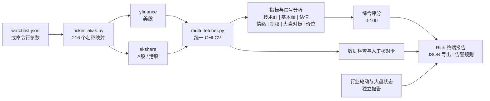
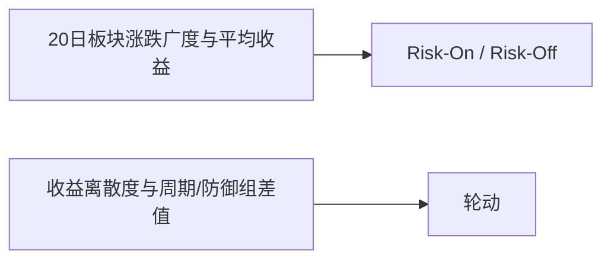
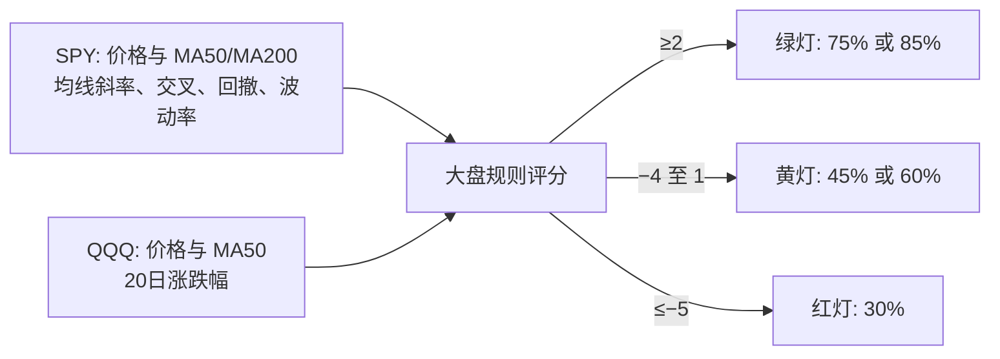
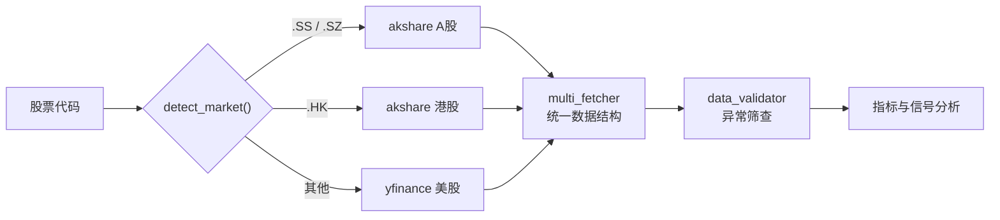

# 📈 Stock Monitor — 多维股票技术分析系统

[](LICENSE)
[](https://www.python.org/)
[](https://github.com/KAMCHIU-LAB/Stock_Monitor)

[English](README.md) | **简体中文**

面向 **美股 / A股 / 港股** 三大市场的规则分析引擎。汇总技术面、基本面、历史估值、新闻、期权、大盘对标和关键价位信号生成评分；数据检查、行业轮动和大盘状态报告提供辅助信息与核验提示。

**无需 API Key,无需数据库,开箱即用** —— 基于 Python 3.10+ 与 yfinance + akshare。

评分是规则汇总，不是校准后的概率或经验证的收益预测。数据检查范围与方法限制见[数据质量说明](AUDIT.md)。

## 快速开始

### 安装依赖

使用 Python 3.10+，在项目根目录执行以下命令（macOS / Linux）：

```bash
python3 -m venv .venv
source .venv/bin/activate
python -m pip install -r requirements.txt
```

### 配置自选股

在项目根目录创建 `watchlist.json`(或运行 `python main.py --init-watchlist` 自动生成):

```json
{
  "_说明": "以 _ 开头的字段是注释,不会被加载",
  "core_index": ["SPY", "QQQ", "IWM"],
  "mag7": ["MSFT", "AAPL", "NVDA", "GOOGL", "AMZN", "META", "TSLA"],
  "hk": ["0700.HK", "9988.HK"]
}
```

支持股票代码与中英文名称混输(由 `ticker_alias.py` 自动解析)。

也支持纯文本格式 `watchlist.txt`:每行一个代码,`#` 开头为注释。

### 运行

```bash
python main.py                         # watchlist.json → watchlist.txt → config.py 默认列表
python main.py -s MSFT GOOGL AAPL      # 只分析指定股票
python main.py -s MSFT --json          # JSON 格式结果
python main.py --watchlist mylist.json # 指定 JSON/TXT 自选股文件
python main.py -s MSFT --local         # 离线样例演示
python main.py -s MSFT --interval 60   # 每 60 分钟自动刷新
python main.py --sector                # 行业轮动排名
python main.py --market-status         # 大盘状态灯
python main.py --all                   # 一键全量分析
```

`--local` 优先读取 `.cache/<symbol>.csv`，文件不存在时生成合成价格数据；它跳过个股外部数据，结果用于演示，不代表当前行情。`--sector`、`--market-status` 和 `--all` 中对应的阶段仍需联网。

`--json` 将结果格式化为 JSON，但拉取数据与加载自选股的提示也可能写入 stdout。用于程序解析前需检查实际输出。

默认的 `watchlist.json`、`watchlist.txt` 和 `.cache/` 已被 gitignore 排除。自定义名称的自选股文件及导出报告不会自动排除；提交或分享前应检查是否包含私人持仓。

---

## ✨ 核心亮点

- 🌏 **三市场一体** —— 美股走 yfinance,A股/港股走 akshare,按代码格式自动识别市场,无需手动配置
- 📐 **按信号权重评分** —— 汇总多空信号权重；行业轮动、大盘状态与数据检查独立展示
- 🚦 **大盘红绿灯** —— 基于 SPY/QQQ 趋势、动量与风险规则，输出绿/黄/红状态
- 🔄 **行业轮动雷达** —— 11 个 SPDR 行业 ETF 多周期涨幅与动量 + 基于价格的 Risk-On/Off 标签
- 🀄 **中英文名直接输入** —— `"茅台"`、`"腾讯"`、`"Microsoft"` 都能自动解析成股票代码(内置 216 个别名)
- 📊 **终端报告** —— 数据核对卡、关键价位推演、信号冲突预警；支持 JSON 格式结果

---

## 系统架构



## 评分模型

### 综合评分

[`calculate_composite_score`](analyzer.py) 汇总看涨与看跌信号的权重：

$$
\text{Base score} = \operatorname{clip}_{0,100}\left(\operatorname{int}\left(50 + 3\left(\sum w_{bullish} - \sum w_{bearish}\right)\right)\right)
$$

每条信号携带自己的 `weight`，中性信号不改变分数。`full_analysis` 收集技术面、基本面、历史估值、新闻情绪、期权、大盘对标和支撑阻力分析中的信号。不同市场的覆盖不同；A股/港股的新闻与期权分析目前返回中性占位信号。

最终分数依次应用两条规则：

1. 若同时存在权重至少为 3 的看涨与看跌信号，将分数向 50 收缩：`int(50 + (base_score - 50) * 0.4)`。
2. 应用技术趋势上限。当前 `强势下跌` 标签将评分上限设为 45；`震荡偏空` 标签不会触发该上限。

`analyzer.py` 中的 `DIMENSION_WEIGHTS` 常量未参与此计算。数据质量附在个股报告中。`sector_rotation.py` 与 `market_status.py` 的输出分别生成独立报告，当前 CLI 未将其传入个股评分；`market_context.py` 则会贡献自己的基准与市场环境信号。

### 技术趋势分类

`analyze_trend` 单独判断方向：

| 检查 | 看涨 / 看跌票数 |
|------|-----------------|
| 收盘价高于 / 低于或等于 MA50 | 2 / 2 |
| MA50 在 10 个观测间隔内变化超过 +0.5% / 低于 −0.5% | 1 / 1 |
| MACD DIF 高于 / 低于或等于零 | 1 / 1 |

缺失值跳过。先判断看涨票数 ≥3 为 `强势上涨`、≥2 为 `震荡偏多`；否则看跌票数 ≥3 为 `强势下跌`、≥2 为 `震荡偏空`，其余为 `横盘震荡`。布林中轨位置仅作辅助展示，不增加票数。

### 评分与标签映射

| 分数区间 | 信号 | 输出代码 |
|:-------:|------|----------|
| 80–100 | 强烈买入 | `STRONG_BUY` |
| 60–79 | 偏多 | `BUY` |
| 40–59 | 中性 | `HOLD` |
| 20–39 | 偏空 | `SELL` |
| 0–19 | 强烈卖出 | `STRONG_SELL` |

阈值取自 [`config.py`](config.py) 的 `THRESHOLDS`，这些是规则标签，并非经验证的交易结果。

## 行业轮动算法

### 多周期动量评分

$$
\text{Momentum} = 3 \times R_5 + 2 \times R_{20} + R_{60}
$$

$R_n$ 为 n 个观测间隔的价格涨跌幅百分比，缺失周期不计入。[`sector_rotation.py`](sector_rotation.py) 同时计算此数值及独立的 5/20/60 周期涨幅排名。终端表格按 20 周期涨幅排序；动量值未归一化至 0–100。

### 基于价格的市场风格标签



| 条件 | 信号 | 解读 |
|------|------|------|
| 可用板块中 ≥70% 上涨，且 20 日平均涨幅 >2% | Risk-On | 广泛正向价格动量 |
| ≥70% 下跌，且 20 日平均涨幅 <−2% | Risk-Off | 广泛负向价格动量 |
| 涨跌幅标准差 >4 个百分点，且组间均值差 >3 个百分点 | 转向周期 / 防御 | 周期组 XLY/XLI/XLE/XLB；防御组 XLP/XLV/XLU |
| 标准差 >4 个百分点，且两组均未达到上述领先条件 | 轮动 | 板块分化 |
| 其余情况 | 中性 | 未命中以上规则 |

规则按表格顺序判断。这些标签根据价格收益推断市场风格，并未测量实际资金流入或流出。

## 大盘状态灯

### SPY / QQQ 规则评分



| 大盘分数 | 状态 | 规则仓位输出 |
|:--------:|------|:------------:|
| ≥5 | 绿灯 / 牛市趋势 | 85% |
| 2–4 | 绿灯 / 偏多震荡 | 75% |
| −1–1 | 黄灯 / 方向不明 | 60% |
| −4–−2 | 黄灯 / 偏弱震荡 | 45% |
| ≤−5 | 红灯 / 熊市趋势 | 30% |

具体权重与阈值见 [`market_status.py`](market_status.py)。SPY 或 QQQ 拉取失败时返回黄灯 / unknown，并以 60% 作为占位值。这些比例是固定规则输出，不是个性化资产配置。

## 数据流水线



`multi_fetcher.py` 的统一历史行情入口直接调用供应商。`data_fetcher.py` 中的其他辅助函数使用 `cache.py`，TTL 由调用方决定；上述流水线没有统一的 30 分钟缓存层。

---

## 股票代码格式

| 市场 | 格式 | 示例 |
|------|------|------|
| 美股 | 直接写代码 | `MSFT`, `NVDA`, `AAPL` |
| A股(上海) | 代码 + `.SS` | `600519.SS` (茅台), `601318.SS` (平安) |
| A股(深圳) | 代码 + `.SZ` | `000858.SZ` (五粮液), `300750.SZ` (宁德) |
| 港股 | 代码 + `.HK` | `0700.HK` (腾讯), `9988.HK` (阿里) |

### 名称解析

支持代码与公司名称混合输入(中文/英文均可):

```json
{
  "my_stocks": ["MSFT", "微软", "Tencent", "0700.HK", "茅台"]
}
```

所有名称在分析前都会被解析为标准股票代码。别名库覆盖美股巨头、港股蓝筹、A股龙头和主流 ETF,共 216 条。

### 常用代码速查

```
美股巨头:
  AAPL  苹果          MSFT  微软          GOOGL Alphabet
  AMZN  亚马逊        NVDA  英伟达        META  Meta
  TSLA  特斯拉

美股其他:
  NFLX  奈飞          AMD   AMD           CRM   Salesforce
  AVGO  博通          ORCL  甲骨文        JPM   摩根大通
  BRK.B 伯克希尔      V     Visa          COST  好市多

指数 / ETF:
  SPY   标普500       QQQ   纳指100       IWM   罗素2000
  DIA   道琼斯        ARKK  ARK创新       SOXX  半导体

行业 ETF(轮动跟踪):
  XLK   科技          XLF   金融          XLE   能源
  XLV   医疗          XLY   可选消费      XLP   必需消费
  XLI   工业          XLB   材料          XLRE  房地产
  XLU   公用事业      XLC   通信服务

港股:
  0700.HK  腾讯       9988.HK  阿里巴巴   9888.HK  百度
  3690.HK  美团       1810.HK  小米       9618.HK  京东

A股:
  600519.SS  贵州茅台  000858.SZ  五粮液  300750.SZ  宁德时代
  601318.SS  中国平安  002594.SZ  比亚迪  600036.SS  招商银行
```

---

## 报告结构

### 数据核对卡

每份报告顶部展示，供人工与券商或另一来源核对。程序执行异常筛查及字段一致性检查，并未自动与独立供应商核验价格。

| 字段 | 说明 |
|------|------|
| 数据日期 | 拉取数据的最后交易日 |
| 收盘价 | 数据源结算价 |
| 实时价 | 实时报价(盘前/盘后可能与收盘价不同) |
| 货币 | USD / HKD / CNY |
| 市场状态 | 盘前 / 盘后 / 盘中 |

### 综合评分

```
██████████████████░░   可视化评分条
Score: 92/100          0-100,越高越偏多
Signal: 强烈买入        5 档:强烈买入/偏多/中性/偏空/强烈卖出
Trend:  多头           三重确认:价格 vs 均线 + 均线斜率 + MACD
```

### 关键价位

```
Current:  $373.51
R1:       $376.00 (前高, +0.7%)
R2:       $386.31 (斐波那契, +3.4%)
S1:       $372.66 (斐波那契, -0.2%)
S2:       $361.63 (斐波那契, -3.2%)
S3:       $355.00 (期权最大痛点, -5.0%)

Upside:   突破 $376 → 目标 $386 → $400
Downside: 跌破 $373 → 支撑 $362 → $355
R/R:      1.1:1
```

---

## 推荐工作流

```bash
# 1. 先看大盘状态 —— 绿灯、黄灯还是红灯?
python3 main.py --market-status

# 2. 比较板块价格动量
python3 main.py --sector

# 3. 分析你的自选股
python3 main.py

# 或者一条命令跑完全部:
python3 main.py --all
```

## 数据源

| 市场 | 数据源 | 需要 API Key |
|------|--------|:----:|
| 美股 | yfinance (Yahoo Finance) | 否 |
| A股 | akshare (新浪 / 东方财富) | 否 |
| 港股 | akshare (新浪 / 腾讯) | 否 |

---

## 项目结构

```
stock_monitor/
├── main.py                # 入口,命令行解析
├── config.py              # 指标参数、建议阈值
├── watchlist.json         # 自选股配置(已 gitignore)
├── watchlist.example.json # 自选股模板
├── watchlist_loader.py    # 自选股加载器(JSON/TXT + 别名解析)
├── ticker_alias.py        # 名称→代码解析(216 个别名)
├── sector_rotation.py     # 行业动量:11 个 SPDR ETF、价格规则标签
├── market_status.py       # 大盘状态:趋势、动量与风险规则
├── analyzer.py            # 信号权重评分、冲突检测、趋势分类
├── indicators.py          # MA / BOLL / RSI / MACD / KDJ 计算
├── signals.py             # 信号检测(金叉死叉 / 背离)
├── patterns.py            # K线形态识别
├── report.py              # Rich 终端报告渲染
├── levels.py              # 支撑 / 阻力 / 斐波那契 / 情景推演
├── fundamentals.py        # 美股基本面 (PE/PEG/ROE)
├── fundamentals_cn.py     # A股 / 港股基本面
├── sentiment.py           # 新闻情绪分析
├── options_flow.py        # 期权资金流 (P/C 比率、异常活动)
├── market_context.py      # 大盘对标、相对强度
├── valuation_history.py   # 历史估值分位
├── data_validator.py      # 数据质量校验(8 项)
├── multi_fetcher.py       # 多数据源分发器
├── data_fetcher.py        # 原始数据拉取(含重试)
├── cache.py               # 本地文件缓存(TTL 由调用方决定)
├── local_data.py          # CSV 样例 / 合成离线演示数据
├── alert_config.py        # 告警规则配置
├── LICENSE                # MIT 许可证
└── README.md              # 项目文档
```

## 常见问题

**"Too Many Requests"** —— Yahoo Finance 频率限制。等 15 分钟重试,或用 `--local` 离线模式测试。

**数据与券商软件对不上** —— 查看报告顶部的数据核对卡，并对齐交易日、时段、货币与复权口径。报价延迟、盘前/盘后字段和数据回填均可能影响比较；本项目未测定各字段的更新延迟。

**自定义指标参数** —— 直接编辑 `config.py`(例如 `RSI_PERIOD = 9`)。

**A股/港股数据** —— 由 akshare 提供,免费无需注册。单只股票拉取失败不影响其他标的分析。

---

## 许可证

MIT License,详见 [LICENSE](LICENSE)。

## 免责声明

本系统仅供学习和研究使用,不构成任何投资建议。数据来自第三方免费 API,不保证 100% 准确。历史表现不代表未来收益,投资有风险,入市需谨慎。

---

## Star History

[](https://star-history.com/#KAMCHIU-LAB/Stock_Monitor&Date)

如果 Stock Monitor 对你的分析有帮助,欢迎点个 ⭐,让更多人发现这个项目。
